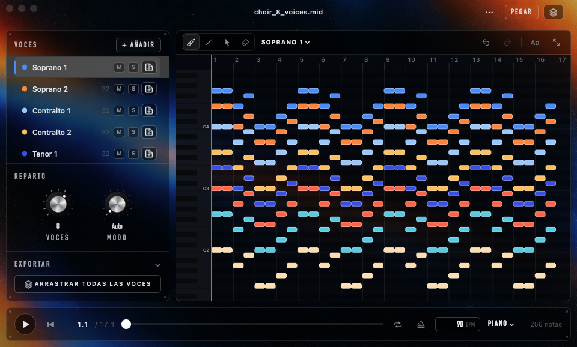
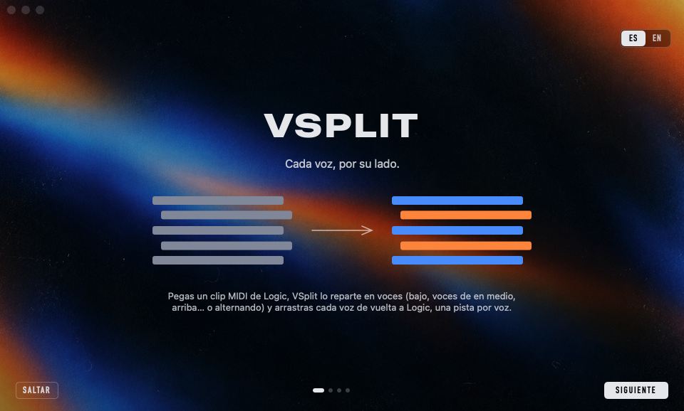
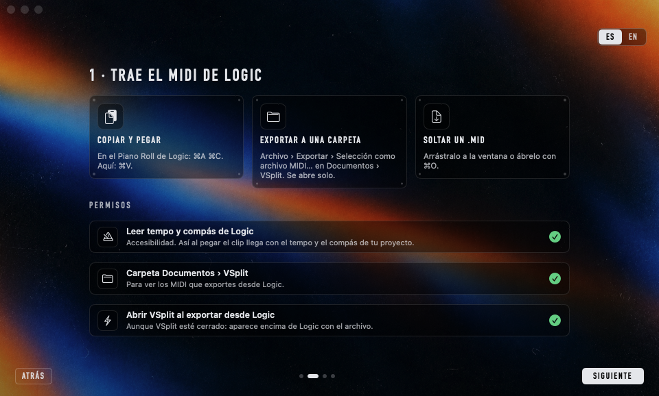
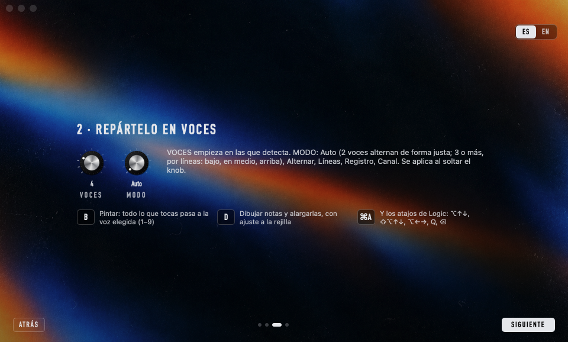
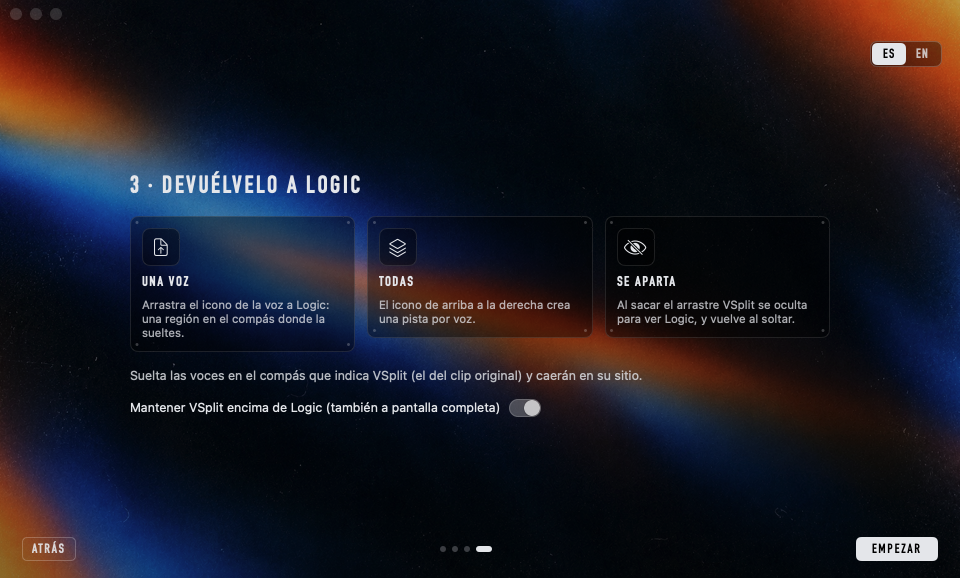

# VSplit

**Separa un clip MIDI de Logic Pro en voces naturales —bajo, voces de en medio, arriba, o alternando— y arrastra cada voz de vuelta como su propia pista.**

[English](README.md) · macOS 14+ · Apple Silicon e Intel · licencia MIT · sin red ni cuentas



Has tocado un pad de acordes o una parte de coro como una sola región MIDI y ahora la quieres en voces separadas: una pista por línea, para panearlas, doblarlas o darle a cada una su sonido. VSplit lee las notas, encuentra las voces como las oiría un músico (el bajo sigue siendo el bajo, la línea de arriba sigue arriba, sin saltos ni cruces) y te devuelve cada voz a Logic como un `.mid` que arrastras al arreglo.

- **Voces naturales**: detecta cuántas voces hay y mantiene cada línea suave. Con dos voces alterna de forma justa (A B A B…) para que las dos mitades tengan las mismas notas.
- **Flota encima de Logic**, también a pantalla completa. Se abre pequeño en la esquina y se aparta cuando arrastras las voces de vuelta.
- **Tres formas de traer el MIDI**: copia las notas en Logic y pega (⌘V); exporta un MIDI a `Documentos › VSplit` y se abre solo; o suelta un `.mid`.
- Pinta voces con la brocha, dibuja y alarga notas con ajuste inteligente, los atajos de Logic (⌥↑↓, ⌥←→, Q…) y deshacer ilimitado.
- Preview con mute/solo por voz, clic como el de Logic y tempo ajustable.
- **Sin dependencias**: Swift puro sobre los frameworks de Apple, con su propio lector y escritor de MIDI.

## Instalación

| Método | Ideal para | |
|---|---|---|
| **[Instalador `.pkg`](https://github.com/jdevesablanco/VSplit/releases/latest/download/VSplit.pkg)** | Lo más fácil: doble clic, sin Terminal | Descarga directa |
| **[Imagen de disco `.dmg`](https://github.com/jdevesablanco/VSplit/releases/latest/download/VSplit.dmg)** | Arrastrar la app a *Aplicaciones* | Descarga directa |
| **Homebrew** | Usuarios de Terminal | `brew install --cask jdevesablanco/tap/vsplit` |
| **Desde el código** | Desarrolladores | `git clone … && Scripts/build-app.sh` |

Al hacer clic en un enlace de descarga, empieza a descargarse directamente (última versión). Todas las versiones: [Releases](https://github.com/jdevesablanco/VSplit/releases).
La app está firmada ad-hoc, no notarizada por Apple, así que la primera vez: *Ajustes del Sistema → Privacidad y seguridad → Abrir igualmente*, o `xattr -dr com.apple.quarantine /Applications/VSplit.app` (ver [docs/NOTARIZATION.md](docs/NOTARIZATION.md)).

## Primer uso

Un tutorial corto explica los tres pasos y pide los permisos que usa VSplit, cada uno con su botón:

- **Accesibilidad**: para leer el tempo y el compás de tu proyecto de Logic al pegar notas.
- **Documentos › VSplit**: la carpeta donde exportas el MIDI desde Logic.
- **Abrir VSplit al exportar desde Logic**: un pequeño ayudante en segundo plano que abre VSplit cuando llega un archivo nuevo a esa carpeta, aunque VSplit esté cerrado.

El tutorial se puede ver en español o en inglés (arriba a la derecha) y se vuelve a abrir desde el menú **⋯**.

| 1 · Bienvenida | 2 · Trae el MIDI | 3 · Repártelo | 4 · De vuelta a Logic |
|:--:|:--:|:--:|:--:|
|  |  |  |  |

## Uso

1. **Trae las notas**
   - *Copiar y pegar*: en el Piano Roll de Logic ⌘A ⌘C, y ⌘V en VSplit. El tempo y el compás se leen de Logic y el clip empieza en el compás de su primera nota (VSplit te dice de qué compás venía).
   - *Carpeta vigilada*: en Logic, *Archivo › Exportar › Selección como archivo MIDI…* en `Documentos › VSplit`. VSplit se abre con él, encima de Logic.
   - O suelta / abre (⌘O) cualquier `.mid`.
2. **Reparte** con los dos knobs: **Voces** (empieza en las detectadas) y **Modo**: *Auto* (con 2 voces alterna de forma justa, con 3 o más separa por líneas), *Alternar*, *Líneas*, *Registro*, *Canal*. Se aplica al soltar el knob; ⌘Z lo deshace.
3. **Retoca a mano** si quieres: *Pintar* (B) pasa a la voz activa todo lo que tocas (elígela con 1–9); *Dibujar* (D) añade notas y cambia su duración con ajuste inteligente; *Seleccionar* (V) y los atajos de Logic.
4. **Devuélvelo**: arrastra el icono de una voz a Logic (una región) o el icono de arriba a la derecha para todas (una pista nueva por voz). Suéltalas en el compás que indica VSplit y caerán en su sitio. VSplit se oculta mientras arrastras y vuelve después.

### Atajos

| Teclas | Acción |
|---|---|
| ⌘V | Pegar notas copiadas en Logic |
| B / D / V / E | Pintar / Dibujar / Seleccionar / Borrar |
| 1–9 | Voz activa (y le asigna la selección) |
| Arrastrar con el botón derecho (Pintar) | Quitar la voz de lo que tocas |
| ⌘A, ⌘I, Esc | Seleccionar todo / invertir / deseleccionar |
| ⌥↑ ⌥↓ · ⇧⌥↑ ⇧⌥↓ | Transponer un semitono · una octava |
| ⌥← ⌥→ · ⇧⌥← ⇧⌥→ | Mover por la rejilla visible · acortar/alargar |
| Q · ← → | Cuantizar · nota anterior/siguiente |
| ⌫ · ⌥⌫ | Borrar notas · quitarles la voz |
| ⌘C / ⌘X | Copiar las notas seleccionadas como `.mid` |
| ⌘Z · ⇧⌘Z o ⌘Y | Deshacer · rehacer |
| ⌘-clic en voces, ⌘J | Seleccionar varias voces, unirlas |
| Espacio · Retorno | Reproducir/parar · al inicio |
| ⌘L · ⌘K | Loop · clic (clic derecho en su icono para el sonido) |
| ⌘+ ⌘− ⌘0 | Zoom · ajustar |
| ⌥⌘F | Mantener encima de otras apps |

## Cómo funciona

- **Voces naturales**: cada acorde (notas cuyos ataques caen en ~35 ms) se reparte con programación dinámica, manteniendo el orden de las voces de arriba abajo y minimizando saltos, cruces y notas metidas en una voz que aún suena; el registro de cada voz sale de los acordes completos y se afina en una segunda pasada. En corales aleatorios a cuatro voces con ritmos independientes coloca el 99,95 % de las notas en su línea.
- **Alternancia justa** (2 voces): alterna dentro de cada acorde y elige por qué voz empieza para que los totales queden igualados y cada línea se mueva lo mínimo.
- **Archivos exportados**: formato 1, con el tempo map, el compás y los marcadores originales, las notas de la voz en sus posiciones exactas y (opcional) CC, sustain y pitch bend copiados a cada voz. Nombre: `<clip>_<voz>.mid`.
- **Encima de apps a pantalla completa**: macOS solo lo permite a apps sin icono en el Dock, así que mientras *Mantener encima de otras apps* está activo VSplit no tiene icono ni barra de menús; los atajos siguen funcionando y lo demás está en el menú **⋯**.
- **Desde Logic**: arrastrar una región MIDI de Logic a otra app o al Finder la convierte en audio (comportamiento de Logic desde la 10.5), por eso VSplit trae las notas copiándolas (Logic deja la lista de eventos en el portapapeles) o desde la carpeta vigilada. El tempo y el compás se leen por Accesibilidad de la barra de control de Logic.

## Compilar

```bash
swift test                 # lector/escritor MIDI, reparto, exportación
Scripts/build-app.sh       # build/VSplit.app (universal, firmada ad-hoc)
Scripts/make-dmg.sh        # build/VSplit-1.0.0.dmg
Scripts/make-pkg.sh        # build/VSplit-1.0.0.pkg
```

También compila con `xcodebuild -scheme VSplit-Package -destination 'platform=macOS' test`. La herramienta de línea de comandos `vsplit` (dentro de la app, y la que instala Homebrew) genera MIDIs de prueba y reparte un `.mid` sin interfaz: `vsplit split archivo.mid --voices 2`.

Publicar una versión: `Scripts/release.sh 1.0.1` (sube la versión, crea el tag; la CI publica el DMG y el PKG en el Release y el script rellena el sha256 del cask).

## Licencia

MIT — ver [LICENSE](LICENSE).
