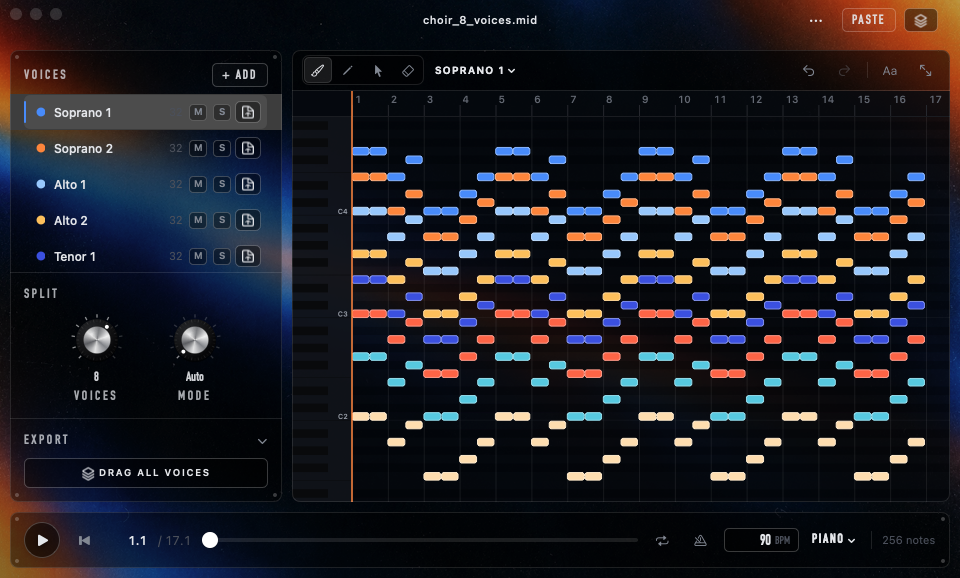
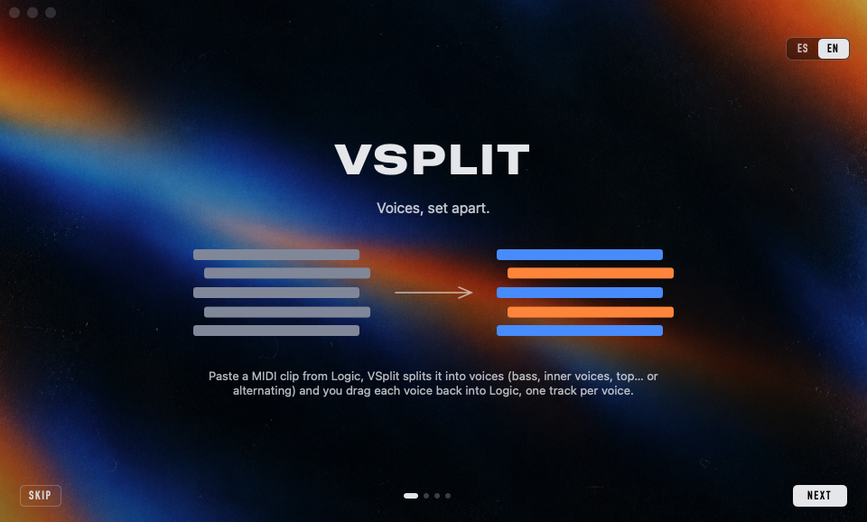
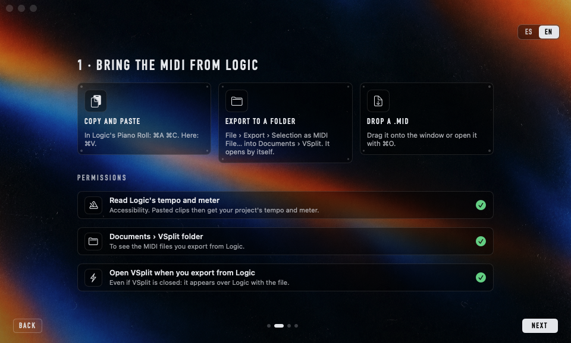
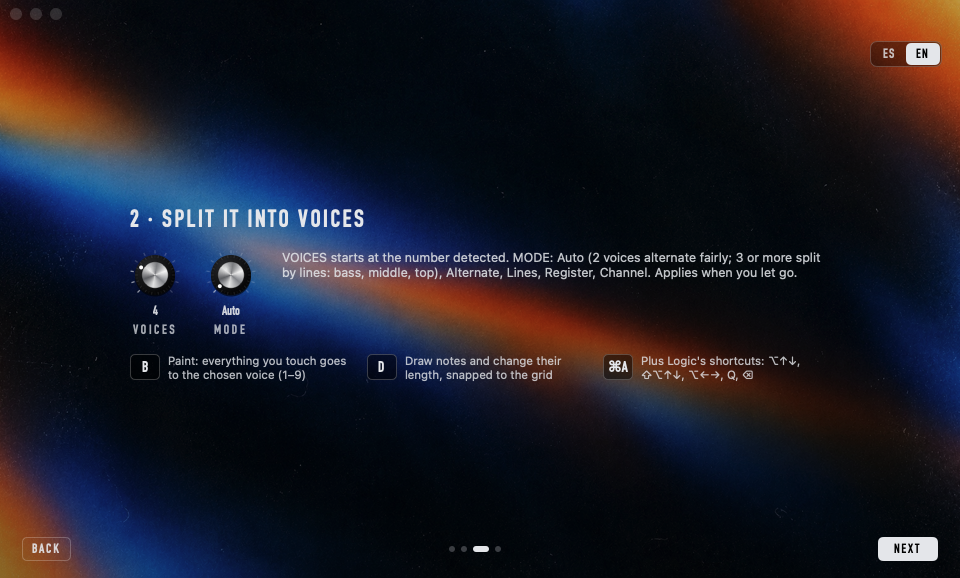
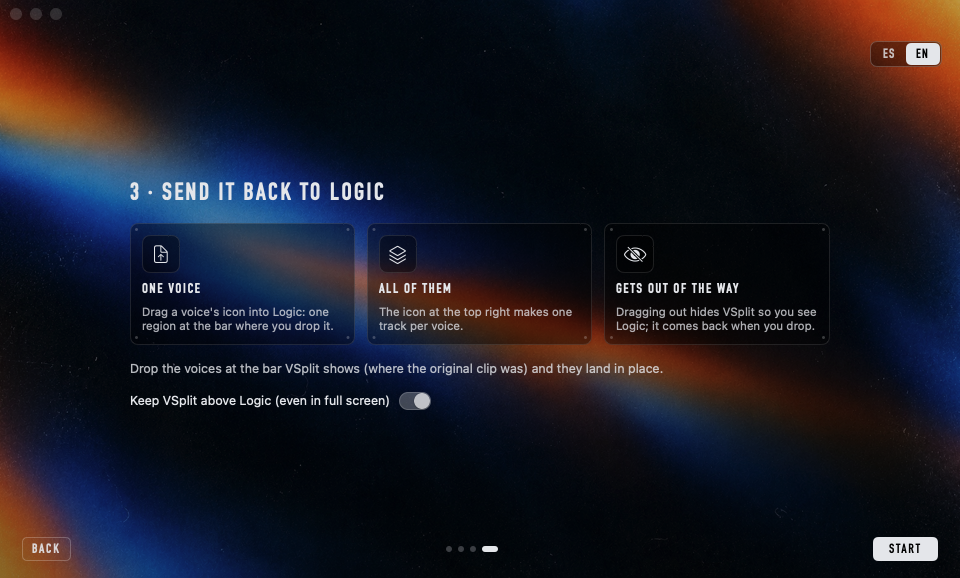

# VSplit

**Split a MIDI clip from Logic Pro into natural voices — bass, inner voices, top, or alternating — and drag each voice back as its own track.**

[Español](README.es.md) · macOS 14+ · Apple Silicon & Intel · MIT licence · no network, no accounts



You played a chord pad or a choir part as one MIDI region and now you want it as separate voices: one track per line, to pan them, double them or give each one its own sound. VSplit reads the notes, finds the voices the way a musician would hear them (the bass stays the bass, the top line stays on top, no jumps or crossings) and hands each voice back to Logic as a `.mid` you drag onto the arrangement.

- **Natural voices**: detects how many voices there are and keeps each line smooth. With two voices it alternates fairly (A B A B…) so both halves get the same number of notes.
- **Floats over Logic**, even in full screen. Opens small in the corner and gets out of the way when you drag voices back.
- **Three ways in**: copy the notes in Logic and paste (⌘V); export a MIDI file to `Documents › VSplit` and it opens by itself; or drop a `.mid`.
- Paint voices with a brush, draw and resize notes with smart snap, Logic's own shortcuts (⌥↑↓, ⌥←→, Q…), unlimited undo.
- Preview with per-voice mute/solo, a Logic-style click and adjustable tempo.
- **No dependencies**: pure Swift on Apple's frameworks, its own MIDI reader/writer.

## Install

| Method | Best for | |
|---|---|---|
| **[Installer `.pkg`](https://github.com/jdevesablanco/VSplit/releases/latest/download/VSplit.pkg)** | Easiest: double-click, no Terminal | Direct download |
| **[Disk image `.dmg`](https://github.com/jdevesablanco/VSplit/releases/latest/download/VSplit.dmg)** | Drag the app to *Applications* | Direct download |
| **Homebrew** | Terminal users | `brew install --cask jdevesablanco/tap/vsplit` |
| **From source** | Developers | `git clone … && Scripts/build-app.sh` |

Clicking a download link starts the download straight away (latest release). All versions: [Releases](https://github.com/jdevesablanco/VSplit/releases).
The app is ad-hoc signed, not notarized by Apple, so the first time: *System Settings → Privacy & Security → Open Anyway*, or `xattr -dr com.apple.quarantine /Applications/VSplit.app` (see [docs/NOTARIZATION.md](docs/NOTARIZATION.md)).

## First run

A short tutorial explains the three steps and asks for the permissions VSplit uses, each with its own button:

- **Accessibility** — to read your Logic project's tempo and time signature when you paste notes.
- **Documents › VSplit** — the folder where you export MIDI from Logic.
- **Open VSplit when you export from Logic** — a small background helper that launches VSplit when a new file lands in that folder, even if VSplit is closed.

You can switch the tutorial between Spanish and English (top right) and open it again from the **⋯** menu.

| 1 · Welcome | 2 · Bring the MIDI | 3 · Split it | 4 · Back to Logic |
|:--:|:--:|:--:|:--:|
|  |  |  |  |

## Using it

1. **Bring the notes in**
   - *Copy & paste*: in Logic's Piano Roll press ⌘A ⌘C, then ⌘V in VSplit. Tempo and meter are read from Logic and the clip starts at the bar of its first note (VSplit shows which bar it came from).
   - *Watch folder*: in Logic, *File › Export › Selection as MIDI File…* into `Documents › VSplit`. VSplit opens with it, on top of Logic.
   - Or drop / open (⌘O) any `.mid`.
2. **Split** with the two knobs: **Voices** (starts at the number detected) and **Mode** — *Auto* (2 voices alternate fairly, 3 or more split by lines), *Alternate*, *Lines*, *Register*, *Channel*. Changes apply when you let go; ⌘Z undoes them.
3. **Fix by hand** if you want: *Paint* (B) turns everything you touch into the active voice (pick it with 1–9); *Draw* (D) adds notes and changes their length with smart snap; *Select* (V) and Logic's shortcuts.
4. **Drag back**: drag a voice's icon into Logic (one region), or the icon at the top right for all voices (one new track each). Drop them at the bar VSplit shows and they land in place. VSplit hides while you drag and comes back afterwards.

### Shortcuts

| Keys | Action |
|---|---|
| ⌘V | Paste notes copied in Logic |
| B / D / V / E | Paint / Draw / Select / Erase |
| 1–9 | Active voice (and assign the selection to it) |
| Right-drag with Paint | Remove the voice from what you touch |
| ⌘A, ⌘I, Esc | Select all / invert / deselect |
| ⌥↑ ⌥↓ · ⇧⌥↑ ⇧⌥↓ | Transpose a semitone · an octave |
| ⌥← ⌥→ · ⇧⌥← ⇧⌥→ | Move by the visible grid · shorter/longer |
| Q · ← → | Quantize · previous/next note |
| ⌫ · ⌥⌫ | Delete notes · remove their voice |
| ⌘C / ⌘X | Copy the selected notes as a `.mid` |
| ⌘Z · ⇧⌘Z or ⌘Y | Undo · redo |
| ⌘-click voices, ⌘J | Select several voices, join them |
| Space · Return | Play/stop · back to start |
| ⌘L · ⌘K | Loop · click (right-click the click icon for its sound) |
| ⌘+ ⌘− ⌘0 | Zoom · fit |
| ⌥⌘F | Keep above other apps |

## How it works

- **Natural voices**: each chord (notes whose attacks are within ~35 ms) is assigned with dynamic programming, keeping voices ordered from top to bottom and minimising leaps, crossings and notes put into a voice that is still sounding; each voice's range is learned from the full chords and refined in a second pass. On random four-part chorales with independent rhythms it puts 99.95 % of the notes on their line.
- **Fair alternation** (2 voices): alternates inside each chord and chooses which voice starts so that the totals stay even and each line moves as little as possible.
- **Exported files**: format 1, with the original tempo map, time signature and markers, the voice's notes at their exact positions and (optionally) CC, sustain and pitch bend copied to every voice.
- **Floating over full-screen apps**: macOS only allows this for apps without a Dock icon, so while *Keep above other apps* is on VSplit has no Dock icon or menu bar; shortcuts still work and everything else is in the **⋯** menu.

## Build

```bash
swift test                 # MIDI reader/writer, splitting, export
Scripts/build-app.sh       # build/VSplit.app (universal, ad-hoc signed)
Scripts/make-dmg.sh        # build/VSplit-1.0.0.dmg
Scripts/make-pkg.sh        # build/VSplit-1.0.0.pkg
```

Also builds with `xcodebuild -scheme VSplit-Package -destination 'platform=macOS' test`. The `vsplit` command-line tool (inside the app, and installed by Homebrew) generates test MIDI files and splits a `.mid` without the UI: `vsplit split file.mid --voices 2`.

## Licence

MIT — see [LICENSE](LICENSE).
